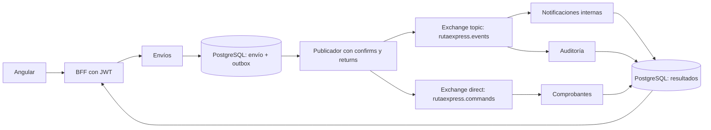

# RutaExpress: mensajería y administración RabbitMQ (EV2)

Servicio Java 21/Spring Boot 4.1.1. Consume eventos de Envíos, guarda notificaciones internas, comprobantes y auditoría en PostgreSQL, y expone una API de administración RabbitMQ protegida con JWT. La versión de integración EV2 se obtiene de `desarrollo`, mediante el [PR #1](https://github.com/matizk/ms-rutaexpress-mensajeria/pull/1). `main` es la base inicial del repositorio, reservada para una entrega validada, no una implementación EV1. Consultar el PR para comprobar la fusión.

Flujo y revisión en [COLABORACION.md](COLABORACION.md). El CI ejecuta Maven verify con Java 21, sin secretos cloud. Actualización documental del 21-10-2026 en `matizk`: el integrante completó el flujo Azure Duoc del caso `RX-1792623980566`; Daniel confirmó en RDS las recepciones AUDIT, NOTIFICATION y TICKET del evento `d88da0d8-4f06-42b0-9f6d-03c7916052c1` y los consumidores activos en RabbitMQ. Esa inspección privada se atribuye a Daniel. [Fuentes y pendientes de cierre](https://github.com/matizk/ms-rutaexpress-envios/blob/matizk/CONTINUAR_EV2_EQUIPO.md). No se declara una nueva integración o despliegue por corregir este texto.

## Laboratorio local, alternativo al AWS existente

Para consumir el despliegue cloud vigente se inicia únicamente Angular local con su proxy al Gateway. Los comandos siguientes son para un laboratorio local elegido expresamente; no ejecutarlos en AWS ni iniciar otro backend solo para probar el operador.

Mantener esta carpeta junto a `ms-rutaexpress-envios`, `ms-rutaexpress-catalogo`, `ms-rutaexpress-reportes`, `ms-rutaexpress-bff` y `frontend-rutaexpress`.

Desde PowerShell, en `ms-rutaexpress-envios`:

```powershell
.\iniciar-ev2.ps1
.\probar-ev2.ps1
```

Solo se necesita Docker Desktop con motor Linux en funcionamiento para ejecutar el stack. El script genera contraseñas aleatorias en `.env.ev2`, ignorado por Git, sin sobreescribir una configuración existente. El proyecto Compose se llama `rutaexpress-ev2` y usa volúmenes nuevos.

La aplicación está en `http://localhost:4200/`. RabbitMQ Management está en `http://localhost:15672/` y `http://localhost:15673/`; usuario `rutaexpress`, contraseña guardada en `RABBITMQ_PASSWORD` dentro del archivo local `.env.ev2`. No se debe copiar esa contraseña a GitHub.

## Flujo y garantías



- Envíos guarda el cambio de negocio y el evento pendiente en la misma transacción PostgreSQL. Si esa transacción falla, ambos se revierten.
- El publicador marca el evento como publicado solo después de recibir confirmaciones de RabbitMQ y comprobar que no hubo devoluciones por falta de ruta. Reintenta con espera creciente, hasta 60 segundos entre intentos. Los eventos pendientes sobreviven al reinicio.
- La entrega es al menos una vez: un fallo parcial puede repetir un mensaje. Cada consumidor guarda una clave única `dominio:eventId` y evita repetir el resultado.
- El ACK se envía después de confirmar la transacción del consumidor. Si falla el ACK, el mensaje puede volver a entregarse sin duplicar el registro.
- Un contrato inválido recibe NACK sin requeue y va a su DLQ. Los errores de base de datos tienen tres intentos; al agotarse se envían a DLQ. Una interrupción del hilo permite reentrega.
- Las notificaciones son internas y persistidas; este servicio no envía correos externos. Los comprobantes se pueden descargar como texto desde Operación. No se publican nombres, correos ni direcciones de destinatarios en los eventos.

## Topología centralizada

Los nombres y routing keys se definen en `src/main/resources/application.yml`. `config/RabbitTopology.java` declara los recursos mediante beans `Declarables`, `Queue`, `Exchange` y `Binding`.

| Cola | Origen y binding | Cola de errores |
| --- | --- | --- |
| `rutaexpress.notifications` | `rutaexpress.events` (topic), `shipment.*` | `rutaexpress.notifications.dlq` |
| `rutaexpress.audit` | `rutaexpress.events` (topic), `shipment.#` | `rutaexpress.audit.dlq` |
| `rutaexpress.tickets` | `rutaexpress.commands` (direct), `ticket.generate` | `rutaexpress.tickets.dlq` |

`rutaexpress.dlx` es el exchange direct que enruta cada error a su DLQ. Colas y exchanges son durables; los mensajes del publicador son persistentes. Las colas principales tienen TTL de 24 horas; sus mensajes expirados pasan a DLQ. Las DLQ conservan los mensajes para inspección y no tienen un consumidor que los borre automáticamente.

El Compose tiene dos nodos RabbitMQ con cookie compartida y descubrimiento estático. Son colas classic: ver dos nodos no acredita replicación de mensajes ni alta disponibilidad. La prueba de recuperación detiene y vuelve a iniciar ambos nodos; no afirma tolerancia a la pérdida permanente de un nodo.

## Contrato de evento versión 1

```json
{
  "schemaVersion": 1,
  "eventId": "ee11a519-0fbc-41da-8511-6cfe9565f264",
  "eventType": "shipment.created",
  "shipmentId": 1,
  "trackingCode": "RX-EV2-TEST",
  "status": "CREADO",
  "occurredAt": "2026-10-15T20:00:00Z"
}
```

Tipos admitidos: `shipment.created` y `shipment.status_changed`. Cada evento se publica al topic con su tipo y al direct con `ticket.generate`. La identidad del evento se conserva en ambos envíos. Las clases de contrato están documentadas en ambos repositorios; no hay una dependencia Maven privada entre ellos.

## API protegida

El frontend llama al BFF; este reenvía el bearer token al servicio. La administración conserva Cognito con firma RS256, emisor, expiración, `token_use=access`, `client_id` y grupo `Admin`. Se aceptan tokens delegados Azure v2 del tenant/API/SPA configurados, solo para `GET /api/operator/confirmations/{codigo}`; nunca conceden administración. Esa consulta devuelve únicamente un ticket TICKET / shipment.status_changed / ACEPTADO, o 404 si todavía no existe. **El entorno cloud del equipo ya tiene Azure configurado y se obtuvo el ticket institucional del caso indicado.** Un laboratorio nuevo debe habilitar/alinear sus propias variables; sus valores por defecto no configuran el despliegue remoto. Guía en la carpeta hermana `frontend-rutaexpress/docs/AZURE_OPERADOR.md`.

| Método y ruta | Función |
| --- | --- |
| `GET /api/messaging/summary` | Totales de notificaciones, comprobantes y auditoría |
| `GET /api/messaging/receipts?trackingCode=RX-...` | Últimos 100 resultados, filtro de código opcional |
| `GET /api/rabbitmq/topology` | Estado de las seis colas y tipos de exchange |
| `GET /api/rabbitmq/queues/{name}` | Mensajes y consumidores de una cola |
| `POST /api/rabbitmq/queues` | Crear cola durable, TTL opcional |
| `POST /api/rabbitmq/exchanges` | Crear exchange direct, topic o fanout |
| `POST /api/rabbitmq/bindings` | Crear enlace exchange-cola |
| `DELETE /api/rabbitmq/bindings` | Eliminar el enlace identificado en el cuerpo |
| `DELETE /api/rabbitmq/queues/{name}` | Eliminar una cola vacía y sin consumidores |
| `DELETE /api/rabbitmq/exchanges/{name}` | Eliminar exchange de demostración |

Solo `GET /actuator/health` es público. Los nombres administrables deben empezar por `rutaexpress.`. Los recursos base de la tabla anterior se mantienen por configuración y no se pueden borrar o alterar mediante la API. Las operaciones dinámicas se prueban con recursos separados como `rutaexpress.demo.queue` y `rutaexpress.demo.exchange`.

Cuerpos de ejemplo para un administrador autenticado:

```json
{"name":"rutaexpress.demo.queue","ttlMillis":60000}
```

```json
{"name":"rutaexpress.demo.exchange","type":"topic"}
```

```json
{"exchange":"rutaexpress.demo.exchange","queue":"rutaexpress.demo.queue","routingKey":"demo.*"}
```

Respuestas: 201 al crear, 204 al eliminar, 400 para entradas inválidas, 401/403 sin autorización, 404 para una cola inexistente, 409 para conflictos y 503 si la dependencia no está disponible.

## Pruebas

Con JDK 21 o superior:

```powershell
.\mvnw.cmd verify
```

Las pruebas cubren ACK después de persistir, contrato inválido, reintentos agotados, errores inesperados, ACK fallido, duplicados y concurrencia; idempotencia en base de datos; validación REST, autorización y validación de claims; protección de colas base y rechazo a borrar colas con mensajes.

La prueba del stack usa PostgreSQL y RabbitMQ reales. Crea datos ficticios, reproduce duplicados y mensajes inválidos, verifica las tres DLQ, detiene y recupera RabbitMQ para comprobar el outbox, y reinicia las tres bases para verificar persistencia. Deja evidencia en `ms-rutaexpress-envios/evidencias/EV2_PRUEBA_LOCAL.md`. No prueba un JWT Azure real ni certifica un despliegue cloud.

## Ubicación del código

- `config`: propiedades y topología, separadas del negocio.
- `events`: contrato, validación, ACK/NACK y reintentos.
- `notifications`, `tickets`, `audit`: consumidores agrupados por dominio.
- `receipts`: resultados persistidos y API de consulta.
- `admin`: servicio RabbitAdmin, controladores y DTO validados.
- `security`: autorización y validación JWT.

Referencias de implementación: [Spring AMQP, confirms y returns](https://docs.spring.io/spring-amqp/reference/amqp/template.html), [API CorrelationData](https://docs.spring.io/spring-amqp/docs/current/api/org/springframework/amqp/rabbit/connection/CorrelationData.html), [RabbitMQ, formación de clúster](https://www.rabbitmq.com/docs/cluster-formation).
